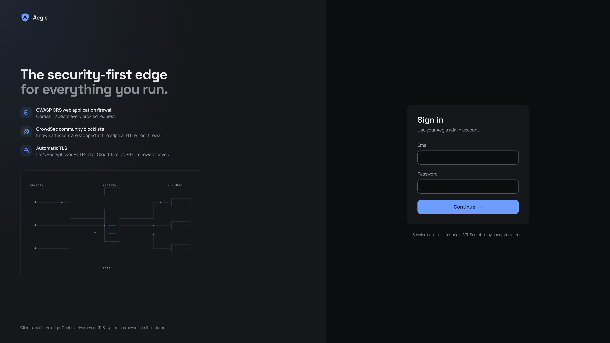
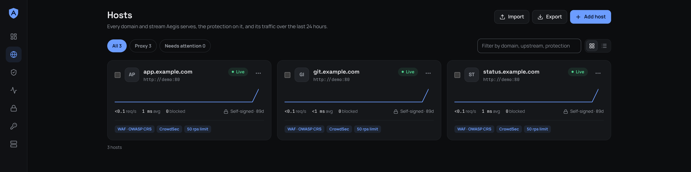

# Aegis

A security-first reverse proxy: a Go edge, a control plane, and a dashboard for the hosts in front of your apps. TLS, the OWASP CRS web application firewall, CrowdSec, and GeoIP are included. MIT licensed.



## Deploy

Docker and Docker Compose are the only requirements.

```sh
git clone https://github.com/zypher-systems/aegis.git
cd aegis
cp .env.example .env
```

Fill in `.env`. Generate each value once and keep it. `AEGIS_SECRET_KEY` encrypts the certificate authority and every certificate private key. Back it up offline. A new key makes stored certificates unreadable.

```sh
# AEGIS_SECRET_KEY            openssl rand -base64 32
# AEGIS_ENROLL_TOKEN          openssl rand -hex 24
# POSTGRES_PASSWORD           openssl rand -hex 16
# CROWDSEC_BOUNCER_KEY        openssl rand -hex 32
# CROWDSEC_FIREWALL_KEY       openssl rand -hex 32
# CROWDSEC_MACHINE_PASSWORD   openssl rand -hex 32
```

`CROWDSEC_BOUNCER_KEY` and `CROWDSEC_FIREWALL_KEY` have to differ. Compose refuses to start when the Postgres or CrowdSec keys are empty.

```sh
docker compose pull api proxy web
docker compose up -d
```

Compose pulls these images, tagged `:latest`, for `linux/amd64` and `linux/arm64`:

- `ghcr.io/zypher-systems/aegis-api`
- `ghcr.io/zypher-systems/aegis-proxy`
- `ghcr.io/zypher-systems/aegis-web`

A push to `main` moves `:latest`. To stay on one build, edit those three `image:` lines in `compose.yaml`. The firewall bouncer is built on the machine. It uses host networking.

Open `http://<this-machine>:3300` and create the first admin. The dashboard is for your LAN or VPN. The proxy is what listens on public `80` and `443`.

| | Address |
|---|---|
| Dashboard | `http://<this-machine>:3300` |
| API | `http://127.0.0.1:18080` |
| Proxy | `:80` and `:443` |

`.env.example` leaves `AEGIS_SELFSIGNED=true`, so the first certificates come from Aegis's own CA and a trial run needs no public DNS. For real names, set `AEGIS_SELFSIGNED=false` and `AEGIS_ACME_EMAIL`. [docs/install.md](docs/install.md) covers HTTP-01, Cloudflare DNS-01, and uploaded certificates.

The stack includes a `demo` upstream (`traefik/whoami`). Add a host for `demo.local` aimed at `demo` port `80` and the dashboard will show it serving traffic.



## Updating

```sh
docker compose pull api proxy web
docker compose up -d
```

Keep the Docker volumes, `AEGIS_SECRET_KEY`, and `POSTGRES_PASSWORD`. Replacing an older checkout is covered in [docs/upgrade.md](docs/upgrade.md).

## From this checkout

To compile api, proxy, and web instead of pulling them:

```sh
docker compose -f compose.yaml -f compose.build.yaml up -d --build
```

Go, Node, and the protobuf tools run in the toolchain container: `./ae go test ./...` and `./ae buf lint`.

## More

- [Install](docs/install.md)
- [Upgrade](docs/upgrade.md)
- [Configuration](docs/configuration.md)
- [Backup](docs/backup.md)
- [Moving a site from Nginx Proxy Manager](docs/migrate-npm.md)
